# Designer UI probe: Dear ImGui natively and in WebAssembly, with Skribidi text

This note records two time-boxed spikes for the UI of the experiment
designer ([rig_spec.md](rig_spec.md) section 7). Part 1 (2026-11-17)
asked whether Dear ImGui, built with SDL3 and GL ES 3.0 and compiled to
WebAssembly with emscripten, can be that UI; the other candidate was a
TypeScript web app. Part 1 builds one program, natively and for the
browser, with the four surfaces the designer needs most: a state chart of
a format 2 definition, a long signal trace, a large trial table and a
stimulus preview through `ysp/gfx.h`. The user then chose ImGui. Part 2
(2026-11-18) puts the repo's pinned Skribidi into that program for user
text: an edit field built on `skb_editor`, a shaped table column and the
state names. Accessibility is out of scope (AccessKit is a later item).
The numbers below are the record.

The source is in `designer/spike/` on the local branch
`designer-ui-spike` (commit d1d543f), not on main (C++ directly against
ImGui, no cimgui). It is not part of the root build. The paths below
that start with `designer/spike/` are on that branch. Dear ImGui, ImPlot, four
Skribidi files and SDL for the web are fetched at pinned versions into a
work folder; Skribidi and its dependencies go into `third_party/`, which
git ignores. None of them is committed.

## Recommendation

1. **Performance does not rule ImGui out, with Skribidi text too.** In
   one 1600 x 900 window with all panels drawn every frame, building the
   UI took a median of 1.2 to 2.1 ms and at most 3.2 ms while a script
   scrolled the 10,000-row table, natively and in three browsers (part 1,
   section 4). With a shaped Skribidi column in that table, the native
   UI took a median of 1.39 to 1.45 ms on a P-core (1.38 ms without the
   column), Chromium 159 1.23 to 1.30 ms and Firefox 159 1.76 to 1.90
   ms; frame-interval p99 stayed at 16.9 ms native, 17.5 ms Chromium and
   17.2 ms Firefox (part 2, section 4). The 600,000-point trace held the
   display's period only with a min/max reduction per pixel column.
2. **Skribidi text in ImGui works, and the browser needs a glue for it.**
   - Display: the Skribidi field, the table column and the state names
     show Arabic joined and right to left, Devanagari conjuncts, and
     mixed lines in bidirectional order, natively and in both browsers.
     ImGui's own text (part 1, section 3) shows none of that and stays
     for the UI chrome only.
   - Editing: click, drag, double click (word), triple click (all),
     arrows, Shift+arrows, Home, End, Backspace, Delete, Ctrl+A, C, X, V,
     Z and Shift+Z work natively. On "abc مرحبا 123 def" the caret moves
     in logical order with an extra stop at each change of direction, and
     a selection over a change of direction shows as separate pieces.
   - Arrival in a browser: SDL 3.4.18, built from source, still takes text
     only from `keypress`. Without glue, `insertText` delivered no
     codepoint and `keyboard.type` only the space, as with SDL 3.4.2. With
     the textarea glue (58 lines of JavaScript, 50 lines of C++), every
     Arabic and Hindi codepoint arrived in Chromium 159 and Firefox 159.
   - Clipboard: natively through SDL, both ways, with X applications.
     In a browser without glue, Ctrl+V reads SDL's in-app clipboard (0
     bytes) and the page sees no paste event, and Ctrl+C does not reach
     the system clipboard. With the glue, paste from and copy to the X
     clipboard worked in both browsers, after one fix: the browser's
     clipboard events come inside the key event, before ImGui has applied
     the keys typed just before (Ctrl+A), so the glue runs those frames
     first.
3. **Three faults in the pinned text stack need work before a release.**
   Select-all and Backspace left a final combining mark (U+0947 after
   "नमस्ते"); the caret after the last codepoint of "नमस्ते" is drawn
   after "नम" (x = 25.4 of a 60 px word) in every build; and Skribidi
   picks fonts per script, so a Hebrew run shows no digits with Noto Sans
   Hebrew, which has none. DejaVu Sans as the last font fixed the digits
   (760 KB more font data). The first two are in Skribidi at commit
   dee63d6; they were not reported or patched here.
4. **IME composition is built and not tested.** Natively the field takes
   `SDL_EVENT_TEXT_EDITING` into `skb_editor_set_composition_utf32()`;
   on the web the glue sends `compositionupdate` the same way. No IME is
   installed on this machine; the manual steps are in part 2, section 6.
5. **Event-driven redraw makes an idle ImGui window cost nothing, with one
   trap.** Natively, `SDL_WaitEventTimeout` gave 0.00 % of one core over
   60 s, with the Skribidi panels too; continuous redraw gave 10.8 %. In
   a browser, pausing the emscripten main loop between events cost the
   same as a blank tab. The trap: ImGui trickles queued input over
   frames, one button or key change per frame, so the loop must draw
   while ImGui's input queue is not empty, and code that acts outside a
   frame (the browser's clipboard events) must drain it first.
6. **Skribidi and HarfBuzz double the wasm.** The wasm grew from 1.69 MB
   to 3.10 MB (463 KB to 807 KB brotli), +1.41 MB raw and +344 KB brotli
   against the part 1 program on the same SDL; HarfBuzz is at least 779
   KB of the code. The fonts grew from 990 KB to 1.78 MB (357 KB to 667 KB
   brotli). The glyph atlas is one 1024 x 1024 page: 1 MB of alpha in
   Skribidi and a 4 MB RGBA copy that ImGui keeps for upload. Cached
   layouts for 10,000 cells take 23.3 MB natively (20.7 MB in wasm).
7. **`ysp/gfx.h` shares ImGui's GL context with no change to the header,
   natively and in WebGL2.** A drifting grating cost 0.04 to 0.07 ms of
   CPU a frame natively (part 1, section 5).
8. **Files and loading.** In the browser, SDL's web backend delivers a
   dropped file with no glue, and a 10-line `EM_JS` function saves a
   download. Natively, `SDL_ShowOpenFileDialog()` failed at once on this
   desktop (no xdg-desktop-portal, no zenity). Part 1's load time from
   navigation to the first frame, median of 5: 260 ms cold and 96 ms warm
   in Chromium 159, 569 and 186 ms in Firefox 128; natively 107 ms. Part
   2's load time was not measured again.

So: ImGui with Skribidi can carry the designer's user text, natively
and in the browser, at a frame cost that fits. Before it ships: the
textarea glue (or an equivalent) in the web build, the two Skribidi
faults, a font list per script that has digits and punctuation, an IME
test by a person, a native file dialog fallback, and accessibility (out of
scope here).

# Part 1: ImGui natively and in WebAssembly (2026-11-17)

Sections 1 to 7 below and their Conditions and Method are part 1's.
They use the emscripten SDL3 port (3.4.2) and ImGui's own text; part 2
changed both.

## Conditions

- Linux desktop: Intel Core i5-14500 (6 P-cores with 2 threads each, 8
  E-cores), AMD Radeon RX 6600, Mesa 22.3.6, Debian 12, kernel
  6.11.5-1-liquorix-amd64, XFCE on X11, X screen 0 at 1920 x 1080 and 60
  Hz (the machine has two X screens; every run used `:0.0`). Device
  pixel ratio 1.
- Background: `radeontop` (root) used about 7 % of one core throughout;
  an idle Firefox ESR window of the user's own profile was open. No
  other measuring job ran. Load averages before each batch: 0.06 to
  1.11 (the `uptime` lines are in the results files).
- Native: GCC 12.2.0, CMake 3.25.1, `Release` (`-O3 -DNDEBUG`), C++17
  with `-fno-exceptions -fno-rtti`, the ysp headers as C99 in one C file.
  SDL 3.4.18 (`/home/bwadmin/sdl3-3.4.18`). GL ES 3.0 context requested
  through EGL (`SDL_HINT_VIDEO_FORCE_EGL`); Mesa gave "OpenGL ES 3.2 Mesa
  22.3.6". Swap interval 1. The window is 1600 x 900.
- Web: emsdk "latest" = emscripten 7.0.0 (777e6e5db7b4990bcaeb1b9998ed642cc84e6629),
  its SDL3 port 3.4.2 (`-sUSE_SDL=3`), CMake `Release` (`-O3`), WebGL 2,
  no threads, no ASYNCIFY (the loop is `emscripten_set_main_loop`),
  `ALLOW_MEMORY_GROWTH`. The fonts and the definition are a
  `--preload-file` package (`spike.data`).
- Dear ImGui v1.93.0 (tag on master, commit
  c1aaac65e896a45f81f47a4d68f9959e0f86c859), not the docking branch;
  `ImDrawIdx` is 32-bit (`imconfig_spike.h`: GL ES 3.0 and WebGL2 have no
  base-vertex draw, and ImPlot's full trace needs about 2.4 million
  vertices). ImPlot master at 72de27832d1e6299bcc930ce01073d899d420392.
  The stock SDL3 and OpenGL3 backends with `IMGUI_IMPL_OPENGL_ES3`.
- `ysp/gfx.h` v0.20.1, `ysp/json.h` v0.2.1, at commit 7d55dcc.
- Fonts: Noto Sans, Noto Sans Arabic and Noto Sans Devanagari, Regular,
  from `/usr/share/fonts/truetype/noto` (Debian's fonts-noto files of
  2020-12-25), merged into one ImGui font at 17 px. No CJK font is
  installed.
- Browsers: Chromium 159.0.8154.6 and Firefox 159.0 from Playwright
  1.65.2 (its `chromium-1255` and `firefox-1572` builds), headed on the
  X display; system Firefox 128.3.1esr, each run with a new profile
  (`--no-remote --new-instance`). Viewport 1600 x 900 CSS pixels.
- Server: `tools/serve.py` (Python 3.10.18 `http.server`) on 127.0.0.1,
  no compression, with COOP and COEP (every page reported
  `crossOriginIsolated` true) and `Cache-Control: max-age=3600`.

## Method

### The program

One source, `designer/spike/*.cpp`, five ImGui windows in a fixed layout
(no ini file, so every start is the same):

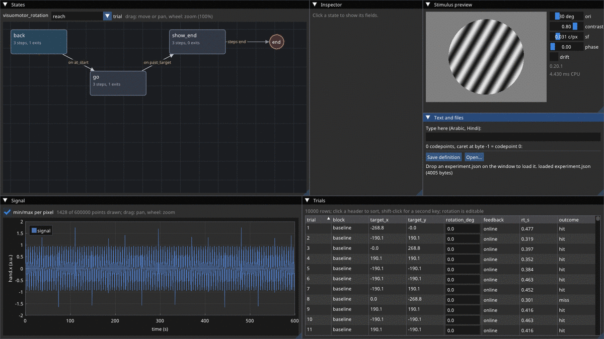

- **States** (item 1, `chart.cpp`). `ysp/json.h` parses the whole
  definition (it fits: a strict reader with a builder and a canonical
  writer). The chart is a custom widget on the window's draw list: a box
  per state, an "end" node, a cubic curve per exit with an arrowhead and
  a label (`on at_start`, `after 0.5 s`, `if $first_in_block`, `steps
  end` for a state without exits, rule 10 of
  [experiment_format.md](experiment_format.md) 3.11). Left drag on a box
  moves it; left drag elsewhere pans; the wheel zooms about the cursor;
  a click selects. Positions are view state and stay out of the file
  (D13). The **Inspector** shows the selected state's steps and exits; a
  `wait_s` or `after_s` is an `InputDouble` with "s" beside it, and `to`
  is a combo. An edit replaces the value in the `yjs` tree; **Save
  definition** writes it with `yjs_write_mem()` (canonical, pretty).

  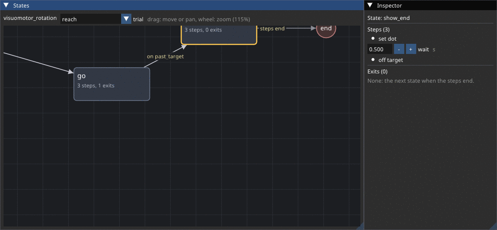

  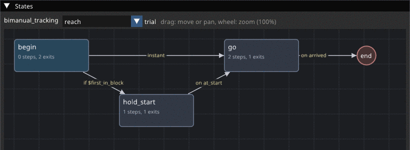

- **Signal** (item 2, `plot.cpp`). 600,000 floats, 10 minutes at 1 kHz:
  three sines, bursts of 45 Hz every 37 s, and noise. ImPlot pans and
  zooms. With "min/max per pixel" on (the default), each frame scans the
  visible samples and draws the minimum and the maximum of each pixel
  column in time order (2 points per column); off (`--plot=full`), it
  calls `PlotLine` with all 600,000.
- **Trials** (item 3, `table.cpp`). 10,000 rows, 8 columns, `ScrollY`
  with a frozen header row, `ImGuiListClipper`, sortable on every column
  with multi-sort (an index array is sorted, the rows stay), and an
  editable `rotation_deg` column (`InputFloat` per visible row). A
  scripted click sorted by `rt_s` and an edit stored 12.5; checked by
  screenshot.
- **Stimulus preview** (item 4, `preview.cpp`). `ygfx_open()` headless
  on the window's context (`desc.gl_proc` from `SDL_GL_GetProcAddress`,
  320 x 240), a sine grating in a circular aperture, sliders for
  orientation, contrast, spatial frequency and phase, and a drift check
  box. It draws only when a value changes or it drifts:
  `ygfx_reset_state()` (ImGui changed the GL state), `ygfx_begin/draw/end`
  with a frame the spike fills, then `glCopyTexSubImage2D` from
  framebuffer 0 into a texture that `ImGui::Image` shows with v flipped.
- **Text and files** (`main.cpp`). One `InputText`; below it, the
  codepoints in the buffer and the caret as a byte and a codepoint index
  (from an `ImGuiInputTextFlags_CallbackAlways` callback); each change is
  printed as a `TEXT` line. Save, and natively an **Open...** button that
  calls `SDL_ShowOpenFileDialog()`.

The idle policy (`--redraw=`): `event` (default) draws only while there
is input in the last 3 frames, ImGui's input queue is not empty, or the
preview drifts; natively the loop then blocks in `SDL_WaitEventTimeout`,
in a browser the `requestAnimationFrame` callback returns at once.
`pause` (web only) also pauses the main loop; an `SDL_AddEventWatch`
callback resumes it on the next event. `continuous` draws every frame.
The caret does not blink (`io.ConfigInputTextCursorBlink = false`): a
blinking caret is an animation.

Frame timing: the first wheel event starts a recording and 1 s without
one stops it, so the same input gives the same window everywhere. Per
drawn frame: **interval** (start to start), **ui** (start to the end of
`ImGui::Render()`: the panels, ImGui and ImPlot on the CPU), **work**
(to the end of `ImGui_ImplOpenGL3_RenderDrawData`), and natively **cpu**
(thread CPU time for the whole frame, swap included). Natively, work
includes the driver's wait for a free back buffer in the first GL calls
of a frame, so it is about 16.6 ms at 60 Hz and is not CPU. In a browser
there is no thread CPU clock; work is wall time in the frame callback,
and the GL calls only queue commands for the GPU process.

### Scripts

`designer/spike/tools/`: `serve.py` (the server, and `/log`, which takes
every line the page prints, so a browser that no script drives still
reports), `pw_drive.py` (Playwright), `x_drive.py` (XTEST through
python-xlib, for the native window and system Firefox; xdotool is not
installed, so it does what `xdotool type` does: binds a keysym to a spare
keycode for one press), `proctree.py` (CPU of a process tree from
`/proc`; pidstat is not installed), `wasm_sizes.py`.

- Load time: the page reports `performance.now()` at the end of the
  first frame's callback (`FIRST_FRAME`), from the navigation start.
  Cold: a new browser and profile per run. Warm: the same page again in
  that browser (Playwright: 0.5 s later; system Firefox: 15 s later, see
  section 1). Native: exec to the end of the first `SDL_GL_SwapWindow`.
- Idle CPU: start, wait 4 s (native), 5 s (Playwright) or 90 s (system
  Firefox, see section 2), then utime + stime of the whole process tree
  over 60 s, window untouched. Playwright's node driver is left out.
- Frame time: the pointer over the table (1200, 760) or the plot (430,
  720), 1 s wait, 300 wheel events 16 ms apart (table: down; plot: 150
  zooming in, 150 out), event mode. XTEST sends X11 wheel buttons 4 and
  5. Playwright's `mouse.wheel(0, 100)` waits for the event to be handled;
  in Chromium the 300 events took 10.0 s (16.1 s on the full trace), in
  Firefox 159 5.0 s (7.1 s), so Chromium got about one event per frame.
- Text: click the field, Ctrl+A and Backspace, enter the text, wait
  0.5 s, screenshot, Home, Right, Right, screenshot. Arabic "مرحبا
  بالعالم" (13 codepoints), Hindi "नमस्ते" (6). Playwright: `insertText`
  and `type` (30 ms delay), stock page and `textglue=1`. XTEST natively
  and in system Firefox (stock page).
- Files: Playwright dispatches `dragenter`, `dragover` and `drop` on the
  canvas with a `DataTransfer` that holds
  `tests/player/bimanual/experiment.json`; then selects show_end, sets its
  wait to 0.75 in the inspector, clicks Save and waits for the download.

## 1. Size and load time

| File | Raw | gzip -9 | brotli 11 |
|---|---|---|---|
| `spike.wasm` | 1,659,562 | 585,860 | 460,886 |
| `spike.js` | 179,791 | 44,416 | 38,185 |
| `spike.data` (3 fonts, 986 KB; the definition, 4 KB) | 990,085 | 461,991 | 356,793 |
| `index.html` | 4,995 | 2,318 | 1,808 |

Bytes; brotli 1.2.1 from Python. The native binary is 6.37 MB, 5.78 MB
stripped; it links SDL3, libGLESv2 and libstdc++.

The wasm relinked with `--profiling-funcs` (1,738,105 bytes; 1,446,223
bytes of code in 1,542 functions), grouped by name: SDL 388,859 (26.9
%), ImGui 339,234 (23.5 %), ImPlot 76,754 (5.3 %), ysp 68,291 (4.7 %),
the spike 24,472, the rest 548,613. The rest is mostly one function,
`web_iter()` (326,194 bytes), into which `-O3` inlined the panels and
ImGui's and ImPlot's templates, and SDL's surface blitters, audio
converters and a deflate encoder, which the spike never calls. The split
is a lower bound for SDL and ImGui.

Time from navigation start to the end of the first frame, ms, 5 runs:

| Browser | Cold | Median | Warm | Median |
|---|---|---|---|---|
| Chromium 159.0.8154.6 (Playwright) | 279.3, 265.6, 197.7, 259.8, 234.3 | 259.8 | 96.0, 76.4, 96.1, 70.0, 104.5 | 96.0 |
| Firefox 128.3.1esr (system) | 647.9, 457.5, 681.9, 484.4, 568.7 | 568.7 | 185.7, 163.0, 17,685.6, 410.4, 170.0 | 185.7 |
| Firefox 159.0 (Playwright) | 289.5, 258.9, 313.1, 304.5, 280.3 | 289.5 | 141.2, 128.6, 165.9, 147.2, 133.7 | 141.2 |
| Native (exec to first swap) | 107.3, 108.6, 104.2, 103.0, 117.6 | 107.3 | | |

- Every warm load transferred 0 bytes (the HTTP cache, no revalidation).
- System Firefox with a new profile is busy for many seconds after it
  starts. With the warm load 0.3 s after the cold one, 5 of 5 warm loads
  took 7.5 to 9.6 s, and `DOMContentLoaded` came 8.2 to 9.2 s after the
  navigation started: the time passed before the page's HTML was parsed,
  not in the spike. With the warm load 15 s later, 4 of 5 took 163 to
  410 ms; one still took 17.7 s (`DOMContentLoaded` at 17.2 s). A user's
  established profile was not measured.
- In one cold Firefox 128 load, the runtime was ready at 446 ms, `main()`
  had loaded the definition, built the trace and opened `ysp/gfx.h` at
  607 ms, and the first frame ended at 616 ms.

## 2. Idle CPU

Percent of one core over 60 s, the whole process tree, window untouched.

| | Blank page | Event (skip in rAF) | Pause main loop | Continuous |
|---|---|---|---|---|
| Native | | 0.00 | | 10.76 |
| Chromium 159 (all processes) | 0.17 | 1.07 | 0.15 | 14.77 |
| Firefox 128 (all processes) | 0.67 | 1.35 | 0.67 | 19.93 |
| Firefox 128, the page's content process | | 0.37 | 0.03 | 12.29 |

The first Firefox batch waited only 10 to 15 s after start: the blank
page then measured 19.56 % and the event mode 25.77 %, mostly the parent
process and the WebExtensions process. That is the new profile's start-up
work, so the table uses a second batch with 90 s of settling. The
Chromium tree includes its GPU process.

## 3. Text entry

What arrived (codepoints in the ImGui buffer after the text was entered):

| Build | Input | Arabic, 13 codepoints | Hindi, 6 codepoints |
|---|---|---|---|
| Native, SDL 3.4.18 | XTEST key presses | 13 of 13 | 6 of 6 |
| System Firefox 128, stock | XTEST key presses | 13 of 13 | 6 of 6 |
| Chromium 159, stock | `insertText` | none | none |
| Chromium 159, stock | `keyboard.type` | U+0020 only | none |
| Firefox 159, stock | `insertText` | none | none |
| Firefox 159, stock | `keyboard.type` | U+0020 only | none |
| Chromium 159 and Firefox 159, `textglue=1` | `insertText` and `keyboard.type` | 13 of 13 | 6 of 6 |

- The order was the order typed in every case that arrived.
- SDL 3.4.2's emscripten backend makes text from `keypress` only
  (`Emscripten_HandleKeyPress`, `SDL_emscriptenevents.c`). `insertText`
  fires `beforeinput` and `input` on an editable element and no key
  event; Playwright's `type` sends a key event for characters on the US
  layout (the space) and `insertText` for the others. An IME sends
  `compositionend` and `input`, so composed text cannot arrive either.
- The glue (`web/index.html`, `textglue=1`): a 1 x 1 transparent
  textarea. The spike replaces the SDL backend's IME function with one
  that tells the page when a field wants text and where the caret is; the
  page focuses the textarea there (so an IME's candidate window opens at
  the caret) and gives the focus back after a canvas click. Committed
  text from `input` and `compositionend` goes to
  `io.AddInputCharactersUTF8()` through an exported function. Printable
  keys and keys inside a composition stop at the textarea, so SDL sees
  no `keypress` (its text input stays off) and no key twice; editing keys
  (Backspace, arrows, Enter, Ctrl combinations) go on to SDL and ImGui.
  Ctrl+A and Backspace cleared the field between cases in both browsers.
- Caret: after Home and two Right presses the caret was at byte 4 =
  codepoint 2 (Arabic) and byte 6 = codepoint 2 (Hindi) in every build
  where the text arrived: logical order. On screen the caret sits after
  the second glyph from the left, because the glyphs are drawn left to
  right.
- Rendering is the same natively and in the browsers: one glyph per
  codepoint, left to right, no shaping, no bidirectional reordering.
  Arabic is shown in isolated forms in reversed reading order and small
  (the Arabic face's metrics at 17 px); Devanagari shows the virama under
  स and no स्त conjunct.

  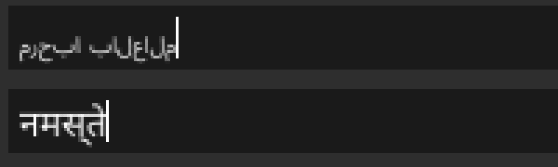

  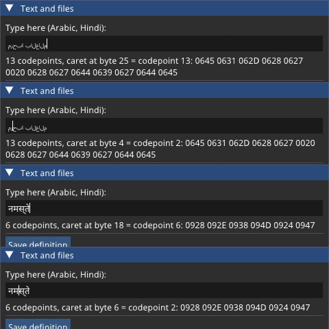

- Japanese IME composition was not tested: no IME framework is installed
  on this machine. Steps for a person, below in Not tested.

## 4. Frame time

Event mode, 1600 x 900, the scripted wheel input of Method. ms; median,
p99 and max; n frames (interval n is one less).

Table scroll (the trace at full view, reduced, is drawn in every frame):

| Build | n | Interval | ui | work | cpu |
|---|---|---|---|---|---|
| Native, unpinned | 295 | 16.67, 16.78, 16.89 | 2.09, 2.13, 2.20 | 16.61, 16.73, 16.76 | 2.19, 2.26, 2.29 |
| Native, pinned to a P-core (CPU 2) | 295 | | 1.38, 1.47, 1.51 | | 1.49, 1.53, 1.57 |
| Native, pinned to an E-core (CPU 16) | 294 | | 2.10, 2.24, 2.48 | | 2.25, 2.28, 2.51 |
| Chromium 159 | 601 | 16.97, 17.39, 17.68 | 1.21, 1.70, 1.78 | 1.60, 2.15, 2.41 | |
| Firefox 128 (system, XTEST) | 290 | 17.04, 17.16, 17.22 | 1.34, 1.86, 1.92 | 1.74, 2.46, 2.76 | |
| Firefox 159 (Playwright) | 303 | 17.04, 17.16, 17.18 | 1.72, 3.12, 3.16 | 2.14, 3.76, 3.86 | |

Trace zoom, min/max per pixel:

| Build | n | Interval | ui | work | cpu |
|---|---|---|---|---|---|
| Native | 295 | 16.66, 16.80, 17.40 | 0.09, 1.39, 1.40 | 16.60, 16.75, 17.14 | 0.19, 1.48, 1.50 |
| Chromium 159 | 601 | 16.75, 17.50, 17.67 | 0.17, 1.66, 1.69 | 0.64, 2.11, 2.20 | |
| Firefox 128 | 290 | 17.04, 17.18, 17.22 | 0.14, 1.82, 1.84 | 0.48, 2.34, 2.34 | |
| Firefox 159 | 302 | 17.06, 17.16, 17.20 | 0.24, 1.80, 1.88 | 0.62, 2.28, 2.32 | |

Trace zoom, all 600,000 points:

| Build | n | Interval | ui | work | cpu |
|---|---|---|---|---|---|
| Native | 288 | 16.66, 25.58, 33.29 | 1.95, 9.43, 9.46 | 16.61, 25.39, 33.10 | 2.06, 25.42, 32.88 |
| Chromium 159 | 900 | 16.53, 43.92, 59.53 | 6.62, 11.92, 12.89 | 7.09, 43.69, 59.28 | |
| Firefox 128 | 254 | 17.04, 73.76, 81.86 | 5.94, 12.48, 12.66 | 6.26, 73.36, 81.48 | |
| Firefox 159 | 344 | 17.06, 53.40, 67.12 | 5.94, 14.38, 14.88 | 6.36, 53.06, 66.34 | |

- The unpinned native process ran at E-core speed (its ui matches the
  E-core run). Core placement was not controlled in the browsers.
- The ui time of the table runs is mostly the reduction's scan of all
  600,000 samples at full view: zoomed in (fewer visible samples) the
  whole UI took a median of 0.09 ms natively. Inferred from the two
  runs, not profiled. A min/max pyramid built once would make the scan
  proportional to the plot's width (not built).
- With all points, the cost is the vertex data: about 2.4 million
  vertices at full view. Natively that is CPU (p99 25 ms); in a browser
  the upload to the GPU process blocks the frame callback (work p99 44 to
  73 ms against ui p99 12 to 14 ms).
- Firefox's frame interval was 17.04 ms (58.7 Hz) on this 60 Hz screen,
  in both versions. Not investigated.

## 5. Stimulus preview

- `ygfx_open()` with `desc.gl_proc` and `desc.width`, `height` = 320 x
  240 on the window's GL ES 3.0 context opened natively and on WebGL2 in
  Chromium 159, Firefox 159 and Firefox 128, with no change to
  `ysp/gfx.h`. `EXT_color_buffer_float` was there in all of them.
- CPU per preview frame, natively: 4.43 ms for the first (the programs'
  first use), 0.04 to 0.07 ms while the grating drifts (three runs, one
  frame each; thread CPU time). In the browsers it was not measured.
- What a cleaner path takes: an option for the output stage to write a
  framebuffer the caller names, or a `ygfx_tex` whose GL name the caller
  can read. Either removes the copy and the dependence on drawing before
  ImGui's clear. The copy also means the preview shows the output stage's
  8-bit device values, not the float scene: the same pixels a rig would
  show with an identity calibration.

## 6. Files

| Check | Chromium 159 | Firefox 159 |
|---|---|---|
| Drop on the canvas, stock page | `SDL_EVENT_DROP_BEGIN`, `DROP_FILE /tmp/filedrop/0/bimanual.json`, `DROP_COMPLETE`; loaded (5,670 bytes) | same |
| Edit, then Save | `experiment.json` downloaded, 6,002 bytes, `wait_s` 0.75 | same |

- SDL 3.4.2 reads each dropped file with a FileReader, writes it to
  `/tmp/filedrop/N/` in emscripten's file system and sends the events.
  The page's own drop glue (`dropglue=1`) was not needed and not tested.
  The drop was a synthetic `DataTransfer` from Playwright, not a drag
  from the desktop.
- Natively, **Open...** called `SDL_ShowOpenFileDialog()`, and the
  callback came at once with "File dialog driver unsupported (supported
  values for SDL_HINT_FILE_DIALOG_DRIVER are 'zenity' and 'portal')". No
  window opened. A native designer on such a desktop needs its own file
  browser or a documented dependency.
- The loaded file replaces the chart (the bimanual definition shows its
  `reach` trial, the first with states).

## 7. Lines of code

| Item | File | Lines | Without blank and comment lines |
|---|---|---|---|
| 1. State chart and inspector | `chart.cpp` | 388 | 344 |
| 2. Signal trace | `plot.cpp` | 96 | 79 |
| 3. Trial table | `table.cpp` | 130 | 116 |
| 4. Stimulus preview | `preview.cpp` | 145 | 122 |
| Loop, idle policy, timing, text, files | `main.cpp` | 472 | 400 |
| Page, text glue (44 lines of script), drop glue (15) | `web/index.html` | 111 | 93 |

## Not tested (part 1)

- IME composition. Part 2, section 6, has the steps for a person. The
  current program sets `SDL_HINT_IME_IMPLEMENTED_UI` to "composition" for
  the Skribidi field, so ImGui's own InputText, whose SDL3 backend handles
  no `SDL_EVENT_TEXT_EDITING`, shows no preedit natively.
- The IME routing fault of [imgui_probe.md](imgui_probe.md) section 5 (a
  second window); the spike has one window.
- Accessibility. The page is one canvas with no DOM content, so a screen
  reader gets nothing from it; no screen reader was run.
- Clipboard with ImGui's own InputText (part 2, sections 1 and 3, tested
  it for the Skribidi field).
- A drop from the desktop natively (XDND needs a person dragging from a
  file manager) and a real drag into a browser.
- The browser's File System Access API (open and save in place).
- Preview cost in the browsers; the preview's first-frame cost after a
  program cache.
- Frame time in continuous mode, in `pause` mode, and with input other
  than the wheel (drags, typing).
- Sorting cost for 10,000 rows (one click sorted; its time was not
  recorded).
- HiDPI, touch, Wayland, Windows, macOS, Safari, and a user's
  established Firefox profile.
- Memory use.


# Part 2: Skribidi text in the ImGui spike (2026-11-18)

## Conditions

- The machine, browsers and server of part 1: Linux desktop, i5-14500
  (CPUs 0 to 11 are the 6 P-cores' threads, 12 to 19 the 8 E-cores),
  RX 6600, Mesa 22.3.6, X11 at 1920 x 1080 and 60 Hz; Chromium
  159.0.8154.6 and Firefox 159.0 from Playwright 1.65.2, headed. System
  Firefox 128 was not used in part 2.
- SDL 3.4.18 on both sides. Native: `/home/bwadmin/sdl3-3.4.18`. Web:
  built from
  `https://github.com/libsdl-org/SDL/releases/download/release-3.4.18/SDL3-3.4.18.tar.gz`
  (sha256 `9c75cf16330322c217dedd2e0609f1124f1b54b8633e763467b4684d0f4334a3`)
  with `emcmake cmake` (Release, static, no threads), linked as
  `SDL3::SDL3-static` in place of `-sUSE_SDL=3`. emscripten 7.0.0.
- Skribidi at dee63d6 with the repo's two patches and its dependencies
  (HarfBuzz 14.6.0, SheenBidi 83f7710, libunibreak 6.1, budouxc a044d49),
  from `tools/vendor_layout.py --write`, built by `third_party/CMakeLists.txt`.
  The rasterizer, image atlas, canvas and layout cache are not in
  `third_party/` (the pack tool does not compile them); the spike takes
  them from the same commit (`vendor_layout.py --extract`) and checks
  their sha256 in `build.sh`.
- C++20 (Skribidi's headers build values with designated initializers),
  `-O3`, as in part 1. `IMGUI_USE_WCHAR32`.
- Fonts for Skribidi, in fallback order: Noto Sans, Noto Sans Arabic,
  Noto Sans Hebrew, Noto Sans Devanagari (Regular, Debian files of
  2020-12-25), then DejaVu Sans (2023-03-10). ImGui keeps part 1's fonts
  for its chrome.
- The scroll and layout runs ran under `taskset -c 0-11` (P-cores only),
  the whole process tree: a first unpinned batch gave a native layout
  median of 9.95 us against 4.81 us pinned, and UI times that moved with
  the core the scheduler chose. Load averages before the batches: 0.16
  to 1.41.

## Method

### What was built

- `skt.cpp` (187 lines) and `skt.h`: the font collection, one shared
  `skb_layout_cache` (a hit costs a hash of the text and a lookup), the
  glyph atlas and the drawing. Skribidi rasterizes alpha glyphs
  (`SKB_RASTERIZE_ALPHA_MASK`) into its `skb_image_atlas`, one fixed
  1024 x 1024 page (a full page starts another, so a page never changes
  size under a texture). Each page is an `ImTextureData` (RGBA32)
  registered with `ImGui::RegisterUserTexture()`; after the panels, the
  dirty rectangle of each page is converted to white plus alpha and
  queued with `ImTextureDataQueueUpload()`, so ImGui's own backend
  uploads it. A glyph is one `AddImage` quad, tinted. Why this route:
  ImGui's GL backend takes RGBA32 textures only, and WebGL2 has no
  texture swizzle that would let an R8 texture show as white plus alpha;
  the backend-managed texture keeps the spike free of its own GL code
  for text and works with any ImGui renderer. The cost is the RGBA copy
  (4 bytes per texel on the CPU, besides Skribidi's 1). Drawing the
  runs through `ysp/gfx.h` into a texture, as the preview does, was not
  tried: one pass per field and per cell, and no caret or selection
  geometry of its own. `RegisterUserTexture()` is in `imgui_internal.h`
  and marked experimental.
- `skf.cpp` (259 lines) and `skf.h`: the edit field on `skb_editor`.
  ImGui item and focus (`ItemAdd`, `SetActiveID`); mouse click, drag,
  double and triple click (Skribidi counts clicks from the times given);
  arrows, Home, End, Backspace and Delete with Shift and Ctrl as
  Skribidi modifiers; Ctrl+A, C, X, V, Z, Shift+Z and Y; characters from
  ImGui's queue (so they keep their order with the keys); a composition
  from `skf_compose()`; selection rectangles, the layout and a caret
  with a tick that shows the direction. While it has the focus it fills
  ImGui's `PlatformImeData` (wanted, caret position, line height), so
  SDL natively, or the glue's textarea on the web, follows the caret.
  Every state change prints one `SKB` line: selection, caret x,
  direction and codepoints.
- Native glue (`main.cpp`): `SDL_HINT_IME_IMPLEMENTED_UI` =
  "composition", and `SDL_EVENT_TEXT_EDITING` to `skf_compose()`.
- Web glue (`web/index.html`, `textglue=1`, 58 lines; `main.cpp`, 50
  lines): part 1's textarea plus `compositionupdate` (to
  `skf_compose()`), `paste` (to the field, or to ImGui's queue),
  `copy` and `cut` (the field's selection into `clipboardData`). Ctrl+C,
  X and V stop at the textarea, without `preventDefault()`, so SDL does
  not see them and the browser fires its clipboard events. Before each
  of those calls, `flush_input()` polls SDL and draws frames until
  ImGui's input queue is empty.
- The table's eighth column, "label", is user text: one of six patterns
  with the trial number (Latin; Arabic; Hebrew; Devanagari; "go → مرحبا";
  "שלום world नमस्ते"), so each of the 10,000 cells has its own text and
  layout. A visible cell asks the layout cache each frame; a right to left
  label is aligned to the cell's right edge. The column sorts bytewise.
- The chart's state names are Skribidi layouts at one size, drawn with
  the zoom as the atlas's pixel scale.

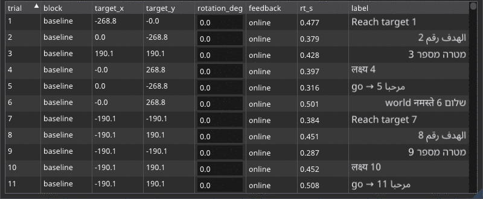

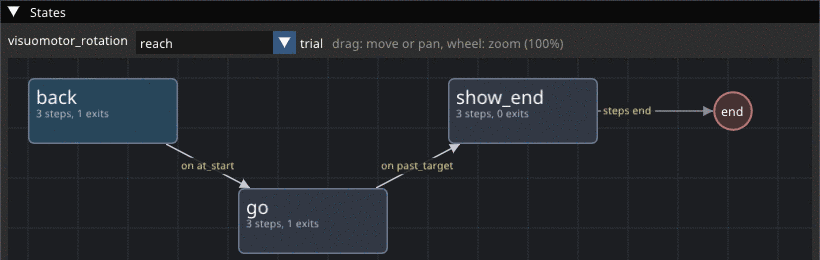

### Scripts

`tools/skb_checks.py` is one sequence for every build: click the field;
for Arabic and Hindi, clear (Ctrl+A and Backspace, twice, because of the
fault in section 3), enter the text, screenshot; on "abc مرحبا 123 def",
Home and 20 Right presses with a screenshot each, then Home, 3 Right and
8 Shift+Right; set the X clipboard with `xclip` to "Pasted שלום 42" and
press Ctrl+V; enter a text, Ctrl+A, Ctrl+C and read the X clipboard with
`xclip -o`. `pw_drive.py skb` runs it in Playwright (`keyboard.type`
and `insert_text`), `x_drive.py native skb` with XTEST (`type` only).
xclip is installed; xsel is not. Headed Playwright browsers use the X
clipboard, so the paste and copy checks are against the system clipboard
in every build, not a page-only one. Mouse and key checks:
`x_drive.py native shot` with clicks, double clicks, triple clicks,
drags and key chords. The table bench (`--bench-table`, `bench=1`)
lays out every label into an empty cache, then asks for every label
again, timing each call, and reads the heap in use (`mallinfo`) before
and after. The scroll runs are part 1's, on the table, without (cold)
and with (warm) the bench at start.

## 1. SDL 3.4.18 on the web

- The stock text path did not change: in Chromium 159 and Firefox 159,
  `insertText` delivered nothing to ImGui's InputText and `keyboard.type`
  of Arabic delivered only U+0020, Hindi nothing, as with 3.4.2.
- Paste without glue, both browsers, with "Pasted שלום 42" on the X
  clipboard: Ctrl+V in the Skribidi field called `SDL_GetClipboardText()`,
  which returned 0 bytes, and the page's `paste` listener (capture, on
  `window`) saw no event. This confirms the reading of the source:
  `src/video/emscripten` has no clipboard driver, so SDL keeps an in-app
  clipboard, and `Emscripten_HandleKey` returns "prevent default" for a
  key with `ctrlKey`, so the browser does not fire `paste`.
- Copy without glue: Ctrl+A, Ctrl+C on "abc 123 def" left the X
  clipboard at its previous text; the text went to SDL's in-app
  clipboard only.
- How sokol does it (`sokol_app.h`, master 8aac87b): with
  `sapp_desc.enable_clipboard`, a `paste` listener on `window` passes
  `clipboardData.getData('text')` to C as `SAPP_EVENTTYPE_CLIPBOARD_PASTED`;
  the V key is a character key, so sokol lets its keydown bubble and the
  browser fires `paste`. Copy (`sapp_set_clipboard_string()`) writes the
  text into a temporary textarea and calls `document.execCommand('copy')`.
  The paste half fits the SDL glue only if Ctrl+V never reaches SDL's
  keydown handler, which is what the spike's glue does; the copy half
  works only inside the key event's user activation, and sokol calls back
  inside the event while SDL and ImGui act frames later, so the spike
  answers the browser's `copy` event instead, after `flush_input()`.
- SDL from source made the part 1 program's wasm 1,693,084 bytes against
  1,659,570 with the 3.4.2 port (+33,514).

## 2. Text arrival and shaping

| Build | Input | Arabic, 13 codepoints | Hindi, 6 codepoints |
|---|---|---|---|
| Native | XTEST key presses | 13 of 13 | 6 of 6 |
| Chromium 159, glue | `keyboard.type`, `insert_text` | 13 of 13 | 6 of 6 |
| Firefox 159, glue | `keyboard.type`, `insert_text` | 13 of 13 | 6 of 6 |
| Chromium 159 and Firefox 159, no glue | `keyboard.type` | U+0020 only | none |
| Chromium 159 and Firefox 159, no glue | `insert_text` | none | none |

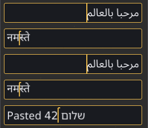

Arabic is joined and runs right to left from the field's right edge; the
caret after the last letter is at its left end. "नमस्ते" shows the स्त
conjunct and the vowel signs in place. A mixed line follows the bidi
algorithm: "abc مرحبا 123 def" shows as "abc 123 مرحبا def" (the number
after Arabic joins the right to left run).

## 3. Editing

Caret walk on "abc مرحبا 123 def" (17 codepoints), natively, from Home,
one Right press each (Skribidi caret mode, the default). Offset is the
caret's text position; a star marks a second stop at the same offset; x
is the caret's position in px from the text's start:

| Press | 0 | 1 | 2 | 3 | 4 | 5 | 6 | 7 | 8 | 9 | 10 |
|---|---|---|---|---|---|---|---|---|---|---|---|
| Offset | 0 | 1 | 2 | 3 | 3* | 4 | 5 | 6 | 7 | 8 | 9 |
| x | 0.0 | 12.3 | 25.9 | 36.4 | 42.2 | 131.9 | 120.4 | 111.7 | 99.6 | 92.0 | 85.6 |

| Press | 11 | 12 | 13 | 14 | 15 | 16 | 17 | 18 | 19 | 20 |
|---|---|---|---|---|---|---|---|---|---|---|
| Offset | 9* | 10 | 11 | 12 | 13 | 14 | 15 | 16 | 16* | 16 |
| x | 79.9 | 42.2 | 54.7 | 67.3 | 131.9 | 137.6 | 151.2 | 163.6 | 174.8 | 174.8 |

The caret moves in logical order. Entering the Arabic word it jumps to
the word's right end and walks left; leaving it, it jumps back to "123",
which is drawn to the left of the Arabic. The browsers ran the same walk
with the glue (`skb_*_glue.txt` in the results). Screenshots of presses
0, 3, 4, 5, 9, 10, 11, 12, 15 and 19:

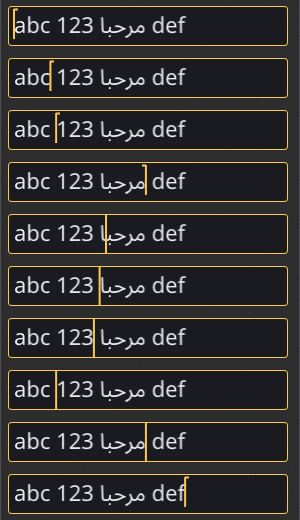

Selection from offset 3 with Shift+Right gave 3..4 up to 3..11; across
the change of direction it shows as two or three separate rectangles
(logical selection, as browsers do):

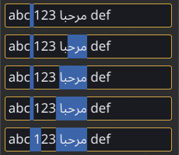

Mouse, natively: a click put the caret at offset 11; a double click on
the Arabic word selected 4..8 (the word); a triple click selected 0..16;
a drag from "a" into the Arabic word selected 0..6.

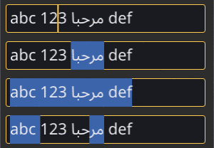

Keys, natively, from the end of the line: typing "xyz" then Ctrl+Z
removed "z", Ctrl+Shift+Z put it back; Ctrl+A, Ctrl+X emptied the field
and Ctrl+V twice gave the line twice (34 codepoints); Home, Delete, End,
Backspace removed "a" and "f".

Faults found:

- Select-all and Backspace on "नमस्ते" left U+0947 (the last vowel sign)
  in the field, drawn on a dotted circle. `skb_editor_select_all()` ends
  the selection at the last grapheme's start with end-of-line affinity
  (from the layout's grapheme data); the removal then takes the next
  grapheme boundary from the rich text's data, which stops one codepoint
  short here. Seen natively in the first run; the scripts then cleared
  twice.
- After "नमस्ते" the caret's offset was at the end (5, trailing) but its
  x was 25.4 px, after "नम", in all three builds; inserted as one string
  through the glue, the editor also reported offset 2.
- Skribidi chooses fonts per script run and falls back only among fonts
  that cover the run's script. Noto Sans Hebrew has no digits, so "מטרה
  מספר 3" showed a box for "3" until DejaVu Sans (Hebrew and digits) was
  added last; the arrow in "go → مرحبا" was a box too (none of the Noto
  files has U+2192).

## 4. The table column and scrolling

Layout time per cell, the 10,000 labels at 16 px, us (P-cores):

| Build | Cold: median, p99, max, mean | Cold total | Cached: median, p99, max, mean | Cached total |
|---|---|---|---|---|
| Native, run 1 | 4.81, 8.66, 194.70, 5.30 | 53.3 ms | 0.09, 0.14, 0.92, 0.093 | 1.18 ms |
| Native, run 2 | 4.82, 8.42, 204.10, 5.28 | 53.0 ms | 0.09, 0.18, 1.90, 0.094 | 1.19 ms |
| Chromium 159 | 10, 35, 1175, 9.43 | 95.8 ms | 0, 5, 20, 0.188 | 2.93 ms |
| Firefox 159 | 20, 20, 120, 10.19 | 102.4 ms | 0, 0, 20, 0.136 | 1.76 ms |

The browsers' clocks step in 5 us (Chromium) and 20 us (Firefox) when
cross-origin isolated, so their medians and p99 are steps; the means
(total / 10,000) are the numbers to compare. The first layout includes
HarfBuzz's first use of each font.

Memory: the cache grew the heap by 23.26 MB natively (24,392,288 bytes,
2.4 KB per layout) and 20.66 MB in wasm (32-bit pointers). The atlas
held all glyphs of the table, the field and the chart in one page:
1,048,576 bytes of alpha in Skribidi and 4,194,304 bytes of RGBA in
ImGui's `ImTextureData`; the GL texture is another 4 MB by its size (not
measured). Heap in use after a scroll run: native 29.9 MB cold and 51.5
MB warm; wasm 16.6 MB and 35.8 MB.

Scrolling the table (part 1's wheel script, event mode, P-cores), ms,
median, p99, max:

| Build | Cache | n | Interval | ui | work or cpu |
|---|---|---|---|---|---|
| Native, run 1 | cold | 293 | 16.66, 16.88, 18.30 | 1.45, 1.55, 18.09 | cpu 1.58, 1.69, 1.86 |
| Native, run 2 | cold | 293 | 16.67, 16.84, 16.87 | 1.45, 1.56, 1.63 | cpu 1.59, 1.76, 1.81 |
| Native, run 1 | warm | 293 | 16.66, 16.90, 16.94 | 1.39, 1.49, 1.53 | cpu 1.52, 1.68, 1.72 |
| Native, run 2 | warm | 295 | 16.67, 16.91, 17.02 | 1.39, 1.46, 1.63 | cpu 1.51, 1.60, 1.81 |
| Chromium 159 | cold | 601 | 16.45, 17.50, 17.60 | 1.30, 1.57, 5.46 | work 1.76, 2.25, 6.11 |
| Chromium 159 | warm | 601 | 16.45, 17.39, 17.53 | 1.23, 1.40, 1.60 | work 1.66, 1.94, 3.06 |
| Firefox 159 | cold | 302 | 17.06, 17.18, 17.22 | 1.90, 2.08, 2.40 | work 2.30, 2.66, 2.92 |
| Firefox 159 | warm | 302 | 17.04, 17.16, 17.18 | 1.76, 1.92, 2.00 | work 2.18, 2.52, 2.56 |

Part 1's native table run on a P-core, without the label column: ui
1.38, 1.47, 1.51. The cold maxima (18.09 ms natively once, 5.46 ms in
Chromium) are frames that laid out and rasterized new labels. The
ui time includes the
trace's reduction scan (part 1, section 4).

## 5. Size

| | wasm raw | gzip -9 | brotli 11 | data raw | data brotli |
|---|---|---|---|---|---|
| Part 1 program, SDL 3.4.18 | 1,693,084 | 590,986 | 463,084 | 990,085 | 356,793 |
| Part 2 program | 3,103,142 | 1,052,460 | 806,725 | 1,776,697 | 666,730 |
| Difference | +1,410,058 | +461,474 | +343,641 | +786,612 | +309,937 |

Relinked with `--profiling-funcs`: code 1,482,145 to 2,460,234 bytes
(+978,089), the data section 203,457 to 633,668 (+430,211, mostly the
text stack's Unicode and model tables). By name, HarfBuzz is at least
779,406 bytes of code and Skribidi 146,412; `-O3` inlined some of both
into their callers, so these are lower bounds. The JavaScript grew by
261 bytes. The data grew by Noto Sans Hebrew and DejaVu Sans. Natively
the binary grew from 6.37 MB to 8.54 MB.

Lines, with comments: the edit widget 259 (`skf.cpp`) + 21 (`skf.h`);
the atlas and renderer 187 + 44 (`skt.cpp`, `skt.h`); the table glue 82
added lines in `table.cpp` (the bench is 40 of them); the chart 5; the
web glue 58 lines of JavaScript and 50 of C++; the native glue and the
field's window about 40 lines of `main.cpp`; the check script 113.

## 6. IME composition: steps for a person

Not testable here: no IME framework is installed, and installing one
was out of scope.

Natively:

1. Install an IME, for example fcitx5 with fcitx5-mozc. `skt.cpp` loads
   Droid Sans Fallback (Debian's `fonts-droid-fallback`) for Han and
   kana, before DejaVu Sans.
2. Start fcitx5. Start the spike from `WORK/native` with
   `XMODIFIERS=@im=fcitx SDL_IM_MODULE=fcitx ./spike`.
3. Click the "Skribidi text" field, press End, switch the IME to
   Japanese, type "nihongo".
4. Expect: stdout shows `TEXT_EDITING` lines and `SKB_COMPOSE` lines
   with the preedit's codepoints; the field shows the preedit inline at
   the caret (in the field's one text color: `skt_draw_layout()` tints every
   glyph alike and ignores the composition's color attribute); the IME's
   candidate window opens next to the
   caret.
5. Press Space to convert, then Enter. Expect an `SKB` line whose
   codepoints end in 65E5 672C 8A9E (日本語)
   and the caret after 語.
6. Repeat with Backspace and arrows inside the preedit: they belong to
   the IME and must not move the field's caret.

In each browser (the same IME, with the browser started from that
session):

1. Start `serve.py` on `WORK/web` and open
   `http://127.0.0.1:8765/index.html?textglue=1`.
2. Click the field and do steps 3 to 6. The page's lines go to the
   server log (`serve.py`'s LOG): expect `SKB_COMPOSE` lines during the
   composition and an `SKB` line with 65E5 672C 8A9E after Enter.
3. Open `...index.html` without `textglue=1` and repeat. Expected from
   section 1: nothing arrives.

## Not tested (part 2)

- IME composition (section 6), and CJK text in general (no CJK font).
- Mouse and key checks in the browsers (the same C++ ran; only arrival,
  the caret walk, the selection and the clipboard were scripted there).
- System Firefox 128, load time with the larger wasm and data, idle CPU
  in the browsers with the Skribidi panels, and the GPU memory of the
  atlas texture.
- A layout cache that evicts (`skb_layout_cache_compact()` is never
  called, so the cache keeps every label it has seen), and the atlas
  filling a second page.
- Multi-line fields, word wrap, scrolling inside a field, and right to
  left paragraphs typed into an empty field.
- Whether the two Skribidi faults are fixed upstream after dee63d6.
- Drawing the text through `ysp/gfx.h` glyph runs (`ysp/outline.h` curves)
  in place of Skribidi's rasterizer.
- Accessibility (out of scope).

# Other references

- [aforren1/lsl-viewer](https://github.com/aforren1/lsl-viewer): a
  released Dear ImGui and ImPlot program on SDL 3.4.18. It draws through
  SDL_GPU, not GL, links SDL statically into one file, opens folders with
  SDL's dialog, and has UI tests with the Dear ImGui Test Engine. Not
  examined in this probe beyond its build file. The designer cannot use
  SDL_GPU for the preview: `ysp/gfx.h` needs a GL ES 3.0 context.

# How to rebuild

From the repository root, with an activated emsdk and SDL 3.4.18. The
script fills `third_party/` (git ignores it), fetches Dear ImGui, ImPlot
and the four Skribidi files, and builds SDL 3.4.18 for the web once:

```sh
sh designer/spike/build.sh WORK /path/to/sdl3-3.4.18 /path/to/emsdk
cd WORK/native && ./spike     # --redraw=continuous, --plot=full, --exp=FILE, --bench-table
uv run --no-project python designer/spike/tools/serve.py WORK/web WORK/server.log 8765
# open http://127.0.0.1:8765/index.html?redraw=event|pause|continuous&textglue=1&bench=1
```

The scripts in Method run with `uv run --no-project --with playwright`
(set `PLAYWRIGHT_BROWSERS_PATH` and run `playwright install chromium
firefox` once) or `--with python-xlib`, with `SPIKE_NATIVE=WORK/native`
or `SPIKE_SERVER_LOG=WORK/server.log`; each prints `RESULT` lines. Part
2's: `pw_drive.py skb chromium|firefox glue|stock OUT`, `x_drive.py
native skb OUT`, and `scroll ... table event cold|warm` under
`taskset -c 0-11`. Part 1's numbers came from the program at commit
653dcfa, with emscripten's SDL3 port.
